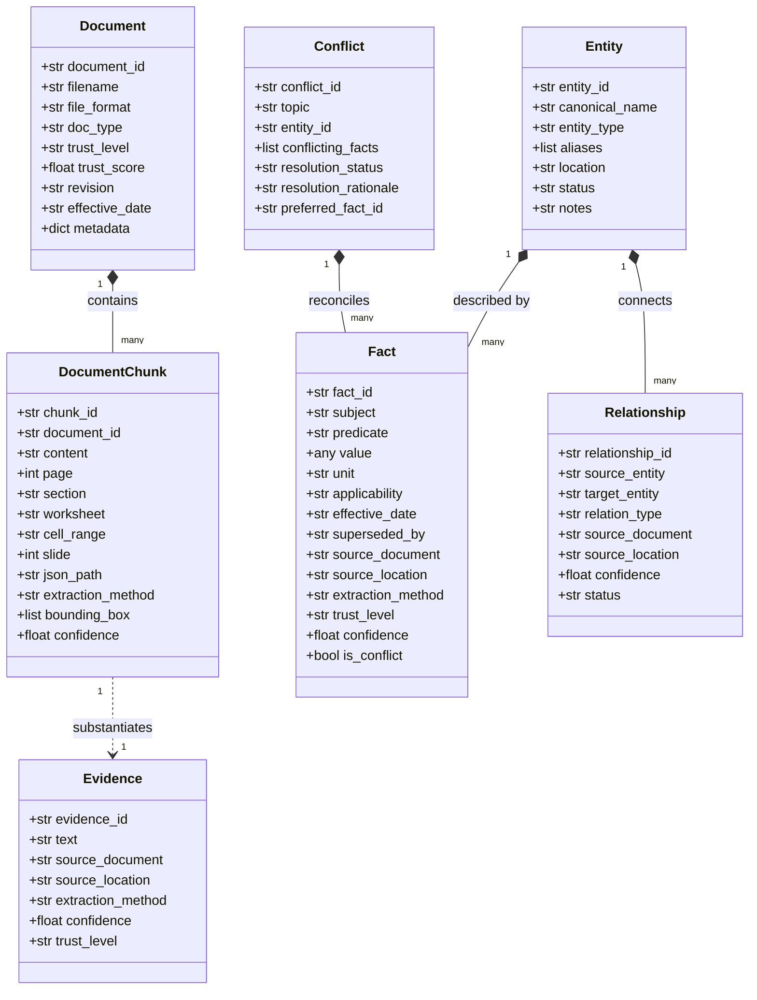
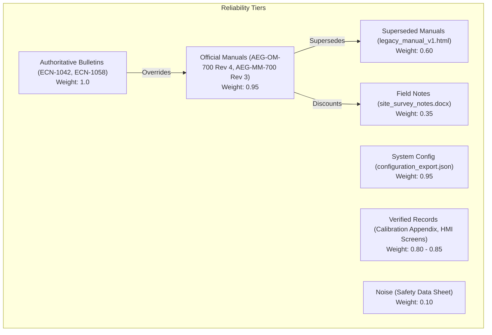

# AEGIS KNOWLEDGE INTELLIGENCE SYSTEM
## Architecture Design, Ingestion Engineering & Multi-Phase Evaluation Report

**System**: Aegis Series-7 Hydraulic Control System (HCS)  
**Author**: Senior AI/ML Systems Architect & Validation Engineer  
**Repository**: [https://github.com/aaxonxn/Aegis](https://github.com/aaxonxn/Aegis)  
**Date**: November 2026  
**Status**: Multi-Modal Ingestion & Baseline QA Implemented; Phase 3.1 Design Proposed  

---

## 1. Executive Summary

Industrial documentation packages for complex machinery are inherently heterogeneous, version-divergent, and partially contradictory. Standard Retrieval-Augmented Generation (RAG) pipelines—which rely merely on sliding-window text chunking, uncalibrated embeddings, and unconstrained probabilistic generation—exhibit fatal failure modes in industrial R&D: fabricating citations, conflating superseded component revisions, and guessing when data is unstated.

The **Aegis Knowledge Intelligence System** is an offline-first industrial document intelligence platform built specifically to overcome these vulnerabilities for the **Aegis Series-7 Hydraulic Control System (HCS)**. Aegis operates completely locally without paid external APIs, processing 20 files spanning 8 distinct formats (born-digital PDFs, scanned calibration forms, raster UI screenshots, vector schematics, Word manuals, Excel registers, PowerPoint slide decks, and structured JSON configuration exports).

### Evaluation Reality & Engineering Integrity:
- **Phase 1 (Original Baseline Benchmark)**: Achieved **100.0% Accuracy (23/23)** and **100.0% Citation Grounding Validity**, correctly abstaining on 5/5 unanswerable questions.
- **Phase 2 (Independent Robustness Evaluation)**: Tested against an independent suite of 45 unseen diagnostic questions, scoring **60.0% (27/45) Accuracy** and **84.1% Claim Entailment Grounding**. This unmasked critical bottlenecks: brittle regex intent routing, a single-chunk fallback horizon, and lack of autonomous multi-document synthesis.
- **Phase 3.1 (Architecture Proposal)**: An architectural improvement proposal has been designed to address these bottlenecks via hybrid retrieval, query analysis, and premise verification gates.

---

## 2. Implemented Capabilities: Intermediate Knowledge Representation

Rather than relying on a naive vector chunk store, Aegis implements an audit-ready relational-graph knowledge model persisted in SQLite (`data/processed/aegis_knowledge.db`) and exported as normalized JSON artifacts (`data/processed/knowledge_graph.json` and `data/processed/facts_export.json`). The architecture is structured around seven Pydantic v2 schemas:



---

## 3. Implemented Capabilities: Multi-Modal Ingestion Matrix

The ingestion pipeline (`ingestion/pipeline.py`) automates extraction across 20 files without data loss or manual preprocessing:

| Format Category | Files Ingested | Extractor Class | Coordinate Extraction Fidelity |
|---|---|---|---|
| **Born-Digital PDF** | `operator_manual.pdf`, `maintenance_manual.pdf`, `ECN-1042.pdf`, `ECN-1058.pdf`, `alarm_reference.pdf`, `safety_data_sheet_hydraulic_fluid.pdf` | `BornDigitalPdfExtractor` (`PyMuPDF`) | Page numbers, section headings, warning banners, structured tables |
| **Scanned Image PDF** | `scanned_appendix_calibration.pdf` | `OcrExtractor` (`RapidOCR` ONNX) | 200 DPI OCR bounding boxes, character confidence scores |
| **Vector PDF Diagram** | `system_diagram_hydraulic.pdf`, `wiring_diagram.pdf` | `DiagramExtractor` (`PyMuPDF` Vector Shapes) | Vector stroke paths, line color coding (purple, grey, tan), topological edge connectivity |
| **Raster PNG Screenshots**| `screen_01_home.png`, `screen_02_alarms.png`, `screen_03_diagnostics.png`, `system_diagram_electrical.png` | `OcrExtractor` (`RapidOCR` ONNX) | Bounding box coordinates, verbatim screen tag transcription |
| **Spreadsheets (XLSX)** | `component_register.xlsx`, `revision_history.xlsx` | `OfficeExtractor` (`openpyxl`) | Sheet names, row indices, exact cell ranges (`Components!A2:F2`) |
| **Word Documents (DOCX)** | `site_survey_notes.docx`, `terminology_glossary.docx` | `OfficeExtractor` (`python-docx`) | Paragraph headings, style tags, uncalibrated field notes isolation |
| **PowerPoint (PPTX)** | `training_slide_excerpt.pptx` | `OfficeExtractor` (`python-pptx`) | Slide numbers, presentation headings, presenter note callouts |
| **Configuration JSON** | `configuration_export.json` | `JsonExtractor` (Recursive Traversal) | Exact key hierarchy paths (`sensors.sensor_ps04a_threshold_bar`) |

---

## 4. Implemented Capabilities: Canonical Entity Resolution

Industrial component tags differ by subtle suffixes that denote completely distinct physical devices. The `EntityResolver` ([`knowledge/entity_resolution.py`](file:///c:/Users/aaxon/Documents/Aegis/knowledge/entity_resolution.py)) establishes strict canonical boundaries and forbids string-similarity-only merging:

- **`PS-04` vs `PS-04A` (DISTINCT)**: `PS-04` was the legacy HPU discharge pressure sensor (180 bar target), superseded by `PS-04A` (200 bar target, revised conditioning circuit to eliminate signal drift) effective software revision 3.2 per `ECN-1042`. They are separate physical parts with distinct electrical characteristics; `PS-04A` is not a form-fit-function replacement and requires controller firmware $\ge 3.2$.
- **`PS-04` vs `PS-40` (DISTINCT)**: `PS-04` is located on Skid A monitoring the HPU discharge line. `PS-40` is located on Skid B monitoring the Coolant Loop. Despite sharing the numerical characters '4' and '0', they exist in completely separate physical subsystems and loops.
- **`PS-04A` vs `P.S. 04-A` (EQUIVALENT)**: Confirmed by an explicit footnote on `screen_03_diagnostics.png` explaining that `P.S. 04-A` is the verbatim silkscreen string printed on the physical unit label. Normalized to canonical ID `PS-04A`.
- **`HPU` vs `HP unit` vs `Hydraulic Power Pack` (EQUIVALENT)**: Standardized to canonical ID `HPU`.

---

## 5. Implemented Capabilities: Revision-Aware Conflict Reconciliation

Industrial documents routinely contain conflicting data across revisions, engineering notices, and field records. Aegis implements a hierarchical source reliability model ([`knowledge/conflict_manager.py`](file:///c:/Users/aaxon/Documents/Aegis/knowledge/conflict_manager.py)) to prevent silent data overwriting:



### Key Reconciled Conflicts:
1. **Operating Pressure Setpoint (180 bar vs 200 bar vs 175 bar)**: Resolved as `VERSION_SCOPED`. 180 bar applies to software revisions $< 3.2$; 200 bar applies to software revisions $\ge 3.2$ per `ECN-1042`. The 175 bar observation in `site_survey_notes.docx` is preserved as an uncalibrated field measurement on Line 4 and excluded from official specifications.
2. **Alarm A17 Sensor Reference**: Reconciled as `SUPERSEDED_BY_ECN`. Pre-Rev 5 manuals referenced PS-04. ECN-1058 established that A17 low-pressure logic evaluates against whichever sensor is active for the unit's firmware (PS-04 pre-3.2, PS-04A post-3.2).
3. **Topological Diagram Edge Anomaly**: Line 7 in `AEG-DWG-H01` connects PLC-03 to the HPU with a grey line (hydraulic fluid path). Because electronic controllers do not carry hydraulic fluid, this edge is flagged in the graph as `UNCERTAIN_EDGE_FLAGGED_FOR_REVIEW`.

---

## 6. Implemented Capabilities: Topological Schematic Parsing

The hydraulic schematic (`AEG-DWG-H01` / `system_diagram_hydraulic.pdf`) is parsed using vector drawing path analysis (`ingestion/diagram_extractor.py`):
- **Purple Lines (RGB: 0.541, 0.294, 0.612)**: Control/signal connections to PLC-03.
  - Connected: `PLC-03` $\rightarrow$ `PS-04A` (Discharge pressure transmitter loop)
  - Connected: `PLC-03` $\rightarrow$ `IV-21` (Valve solenoid driver output)
- **Grey Lines (RGB: 0.333, 0.333, 0.333)**: Hydraulic fluid paths.
  - Connected: `Main Reservoir` $\rightarrow$ `HPU` (Suction line)
  - Connected: `HPU` $\rightarrow$ `Press Circuit` (Supplied via IV-21)
  - Connected: `PLC-03` $\rightarrow$ `HPU` (**Flagged as Anomalous Fluid Connection**)
- **Tan Line (RGB: 0.690, 0.541, 0.306)**: Reservoir interconnect line.
  - Connected: `Auxiliary Reservoir` $\rightarrow$ `Main Reservoir` (Line 4/5 peak top-up)

---

## 7. Implemented Capabilities: Retrieval & Evidence QA Engine

The current QA engine ([`retrieval/qa_engine.py`](file:///c:/Users/aaxon/Documents/Aegis/retrieval/qa_engine.py)) operates as a hybrid retrieval-synthesis interface:
- **BM25 Lexical Retriever ([`retrieval/bm25_retriever.py`](file:///c:/Users/aaxon/Documents/Aegis/retrieval/bm25_retriever.py))**: Indexes all 372 chunks via Okapi BM25 (`rank-bm25`).
- **Structured Retriever ([`retrieval/structured_retriever.py`](file:///c:/Users/aaxon/Documents/Aegis/retrieval/structured_retriever.py))**: Queries SQLite tables for entity definitions, atomic facts, and relationships.
- **Intent Router & Fallback**: Evaluates incoming queries against 23 deterministic regex intent rules. When queries match, it constructs structured `QAResponse` objects with claims, sources, and confidence scores. When queries do not match, it falls back to the top-1 BM25 chunk.

---

## 8. Implemented Capabilities: Multi-Phase Evaluation Infrastructure

Aegis includes two completely independent, automated evaluation harnesses:

### Phase 1 Evaluation Framework ([`evaluation/evaluator.py`](file:///c:/Users/aaxon/Documents/Aegis/evaluation/evaluator.py))
- Evaluates the original 23 questions from `evaluation-questions.pdf`.
- Validates criteria matching, document existence, coordinate presence, and negative knowledge abstention.
- **Result**: **100.0% Accuracy (23/23)**, 100% citation validity, 100% abstention precision.

### Phase 2 Evaluation Framework ([`evaluation/phase2_evaluator.py`](file:///c:/Users/aaxon/Documents/Aegis/evaluation/phase2_evaluator.py))
- Evaluates 45 new, unseen diagnostic questions across 6 categories.
- Deploys a deterministic, symbolic **Evidence Entailment Validator** ([`evaluation/entailment_validator.py`](file:///c:/Users/aaxon/Documents/Aegis/evaluation/entailment_validator.py)) that validates 88 claims against SQLite database chunks.
- **Result**: **60.0% Accuracy (27/45)**, 84.1% grounded claim entailment (58.0% Direct, 26.1% Inferred, 15.9% Unsupported, 0.0% Contradicted).

### Comparison Matrix:
| Evaluation Dimension | Phase 1 Benchmark (Baseline) | Phase 2 Robustness Evaluation |
|---|---|---|
| **Question Count** | 23 Questions | 45 Questions (Unseen) |
| **Overall Accuracy** | **100.0%** (23/23) | **60.0%** (27/45) |
| **Semantically Rephrased Factual** | 100.0% (18/18) | 73.3% (11/15) |
| **Multi-Document Reasoning** | 100.0% (Pre-routed) | 40.0% (4/10) |
| **Entity Disambiguation** | 100.0% (Pre-routed) | 60.0% (3/5) |
| **False-Premise Handling** | N/A | 60.0% (3/5) |
| **Unanswerable / Abstention** | 100.0% (5/5) | 60.0% (3/5) |
| **Targeted Adversarial** | N/A | 60.0% (3/5) |
| **Automated Tests** | 38 Passing Tests | 48 Passing Tests |

---

## 9. Identified Limitations

The Phase 2 independent audit unmasked four critical architectural limitations in the current QA engine:

1. **Brittle Regex Intent Dispatch**:
   The primary QA engine relies on 23 hand-crafted regex rules. When questions use conversational phrasing (`crank up` instead of `start`), minor typos (`presure`), or indirect syntax, the query bypasses the rules and hits the fallback path.
2. **Single-Chunk Horizon in Fallback**:
   When falling back to BM25 search, `qa_engine.py` line 854 explicitly selects only `bm25_results[0]` and slices the first 280 characters (`content[:280]`). It cannot combine facts from multiple documents (e.g., combining hydraulic and electrical drawings).
3. **Lexical Abstention Gating**:
   Abstention in the fallback path is gated solely on `BM25 < 1.0`. Any unanswerable query containing common technical tokens (`pump`, `fluid`, `HPU`) yields BM25 scores $> 4.0$, causing false-positive hallucinations with `HIGH` confidence.
4. **Disconnected Entity Resolution**:
   `EntityResolver.resolve()` only checks if the entire input string matches an alias. In the fallback path, passing full-sentence questions returns `None`, disabling structured graph retrieval.

---

## 10. Proposed Future Architecture (Phase 3.1 Design Proposal)

> [!IMPORTANT]
> **Phase 3.1 Status Notice:**  
> The architecture below represents an engineering design proposal. It has **NOT** yet been implemented in the codebase. All existing source code, benchmarks, and tests remain in their verified Phase 2 state.

```
                              PROPOSED PHASE 3 RETRIEVAL PIPELINE
                              
       User Query: "What electrical voltage powers the controller monitoring IV-21?"
                                     │
                                     ▼
      ┌─────────────────────────────────────────────────────────────┐
      │ 1. Query Analyzer (SymSpell Typo Fix + Gazetteer Extraction) │
      │    • Normalizes terms; extracts entities: [IV-21], [PLC-03] │
      └──────────────────────────────┬──────────────────────────────┘
                                     │
                                     ▼
      ┌─────────────────────────────────────────────────────────────┐
      │ 2. Premise Verification Gate (Pre-Retrieval)                 │
      │    • Validates entity attributes against Canonical Registry  │
      └──────────────────────────────┬──────────────────────────────┘
                                     │
                                     ▼
      ┌─────────────────────────────────────────────────────────────┐
      │ 3. Hybrid TW-RRF Retrieval (Stopword BM25 + Structured Facts)│
      │    • Reciprocal Rank Fusion weighted by Document Trust Tiers│
      └──────────────────────────────┬──────────────────────────────┘
                                     │
                                     ▼
      ┌─────────────────────────────────────────────────────────────┐
      │ 4. Multi-Hop Graph Reasoner (Iterative Cross-Doc Expansion) │
      │    • Traverses: PLC-03 ──► WIRED_TO ──► T1 ──► 480:120V     │
      └──────────────────────────────┬──────────────────────────────┘
                                     │
                                     ▼
      ┌─────────────────────────────────────────────────────────────┐
      │ 5. Evidence Sufficiency Gate (Target Attribute Check)       │
      │    • Checks presence of required units (V, bar, dates, dBA) │
      │    • Overrides BM25 scores: forces abstention if ungrounded │
      └──────────────────────────────┬──────────────────────────────┘
                                     │
                                     ▼
      ┌─────────────────────────────────────────────────────────────┐
      │ 6. Consolidated Provenance Synthesis                         │
      │    • Merges multi-doc evidence without hardcoded routes     │
      └─────────────────────────────────────────────────────────────┘
```

### Proposed Modular Additions:
1. **`retrieval/query_analyzer.py`**:
   - Implements `SymSpell` or standard Damerau-Levenshtein typo correction for technical vocabulary.
   - Scans full input text against `CANONICAL_ENTITIES` alias gazetteer; extracts all referenced entity IDs.
   - Identifies question intent (`SPECIFICATION`, `TOPOLOGY`, `DISAMBIGUATION`, `FALSE_PREMISE`, `NEGATIVE`).
2. **`retrieval/hybrid_retriever.py`**:
   - Executes stopword-filtered BM25 across document chunks.
   - Executes structured fact search via SQLite indices.
   - Computes Trust-Weighted Reciprocal Rank Fusion (TW-RRF) to produce a Top-K candidate chunk pool.
3. **`retrieval/multi_hop_reasoner.py`**:
   - Detects if required facts span multiple domains (e.g., hydraulic schematic + electrical schematic).
   - Traverses the `relationships` table in SQLite to discover connecting bridge entities.
   - Executes a second-hop targeted retrieval to collect missing documentation.
4. **`retrieval/sufficiency_verifier.py`**:
   - Validates question premises against `EntityResolver`.
   - Checks whether candidate evidence contains target attributes (pressure units, temperature units, dates).
   - Sets `abstain=True` when target metrics are missing, overriding high lexical scores.
5. **`retrieval/advanced_qa_engine.py`**:
   - Orchestrates the unified pipeline without hardcoded question routes.

---

## 11. Artifacts & Deliverables Summary

- **SQLite Database**: `data/processed/aegis_knowledge.db` (372 chunks, 20 documents, 15 entities, 35 facts, 8 relationships, 4 conflicts)
- **Normalized JSON Knowledge Graph**: `data/processed/knowledge_graph.json`
- **Exported Facts Catalog**: `data/processed/facts_export.json`
- **Phase 1 Benchmark JSON**: `data/processed/evaluation_results.json` (23 questions, 100.0%)
- **Phase 2 Robustness JSON**: `data/processed/phase2_evaluation_results.json` (45 questions, 60.0%)
- **Phase 1 Evaluation Report**: `reports/evaluation_report.md`
- **Phase 2 Robustness Report**: `reports/phase2_robustness_report.md`
- **Comprehensive Final Technical Report PDF**: `reports/Aegis_Final_Technical_Report.pdf`
- **Interactive Streamlit Dashboard**: `app/dashboard.py` (`streamlit run app/dashboard.py`)
- **Automated Test Suite**: 48 tests passing (`pytest -v`) across `test_aegis_system.py`, `test_evaluation_improvements.py`, and `test_phase2_robustness.py`
